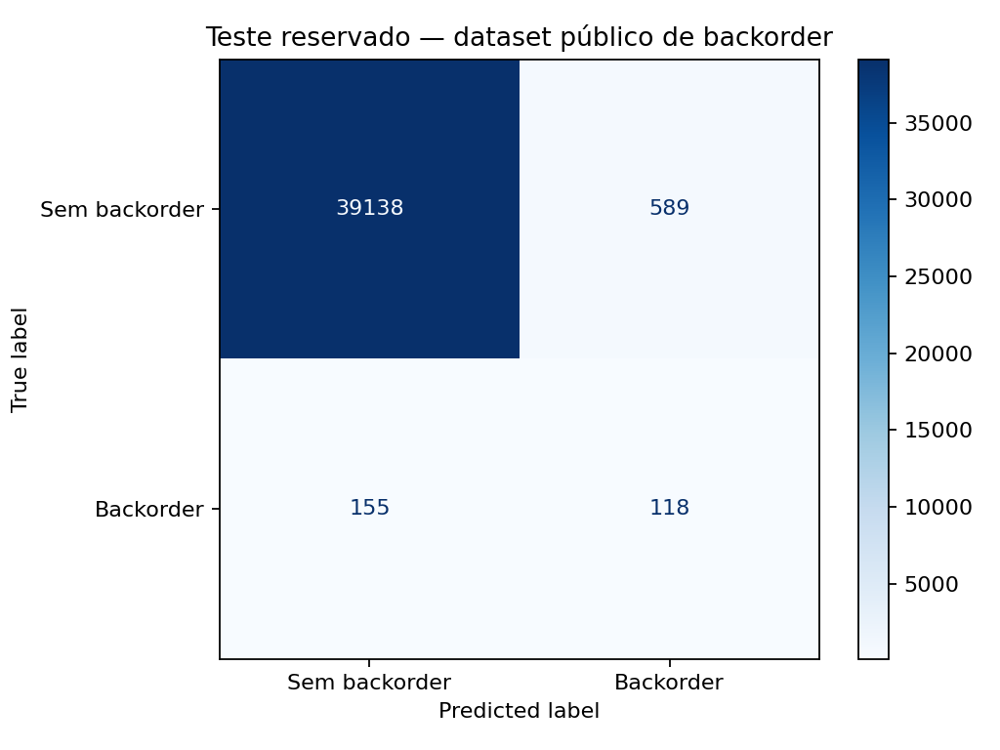

# Agro Intelligence AI — Relatório acadêmico da Etapa 2

## Objetivo e organização

Desenvolvi o Agro Intelligence AI para apoiar a análise comercial de insumos agrícolas na disciplina AI Factory da PUCPR. Integrei Streamlit, Gemini, DuckDB, ChromaDB, um classificador scikit-learn, dois agentes especializados e observabilidade com Langfuse. Minha proposta foi reunir consultas comerciais, documentos e inferência estatística no mesmo chat, mantendo clara a origem de cada informação.

Utilizei uma base comercial integralmente fictícia, com 5.000 clientes, 1.000 produtos, 8.000 pedidos, 20.000 linhas comerciais e 3.000 posições de estoque. Não usei dados reais da C.Vale. Separei faturamento realizado, carteira pendente e pedidos cancelados para evitar dupla contagem. Para margem regional, utilizei a diferença entre receita líquida e custo dos itens faturados, dividida pela receita líquida. Essa medida representa margem comercial bruta, não lucro líquido.

## Agentes, ferramentas e conhecimento recuperado

Implementei uma solução equivalente de agentes em Python. Meu agente de estoque consulta posições e pedidos pelo DuckDB, diferencia ruptura observada, definida como saldo disponível zero, de insuficiência com saldo positivo e acessa o classificador quando recebe entradas compatíveis. Meu agente comercial consulta faturamento, margens e descontos, recupera documentos pelo ChromaDB e analisa impactos associados às evidências compartilhadas.

As ferramentas reais incluem `duckdb_estoque_pedidos`, `duckdb_comercial`, `duckdb_impacto_pares`, `duckdb_impacto_rupturas_total`, `chroma_rag_comercial` e `scikit_learn_backorder`. Nas tarefas compostas, compartilho resultados de estoque com o agente comercial e produzo uma resposta coordenada. Uso consultas fixas, agregadas e limitadas, sem SQL arbitrário gerado pelo modelo. Os três documentos comerciais fictícios fundamentam o RAG; não os substituí para favorecer avaliações.

## Classificação experimental de backorder

Não treinei o modelo com a base comercial sintética: ela contém uma fotografia de estoque, sem rótulo futuro legítimo. Usei o dataset público *Can You Predict Product Backorders?*, obtido por espelho documentado em commit fixo. O arquivo contém 1.687.861 linhas lidas, das quais 1.687.860 são elegíveis. Trabalhei com amostra uniforme de 200.000 registros, semente fixa e alvo original `went_on_backorder`, cuja classe positiva é `Yes`.

Treinei um `HistGradientBoostingClassifier` com pesos de classe balanceados. Utilizei exatamente `national_inv`, `lead_time`, `in_transit_qty`, `forecast_3_month`, `sales_1_month`, `sales_3_month` e `min_bank`. Separei 128.000 registros para treino, 32.000 para validação e 40.000 para teste, agrupando vetores de atributos idênticos para impedir sobreposição entre partições. Como não existem datas utilizáveis, não apresento essa divisão como validação temporal. Escolhi o limiar 0,91 pelo F2 da validação, sem ajustar pelo teste.

No teste reservado, registrei accuracy 0,9814, precision 0,1669, recall 0,4322, F1 0,2408 e ROC-AUC 0,9359. A matriz contém 39.138 verdadeiros negativos, 589 falsos positivos, 155 falsos negativos e 118 verdadeiros positivos. Priorizei recall na análise comercial porque deixar de identificar um backorder pode comprometer atendimento, mas reconheço o custo dos falsos alarmes e a baixa precisão. A baseline majoritária alcançou accuracy 0,9932 e recall zero; portanto, accuracy isolada é enganosa nesse conjunto desbalanceado.

Integrei a inferência local ao chat sem pedir ao Gemini que invente previsões. Em G12, as sete entradas explícitas produziram score aproximadamente 0,9267. Esse score não é probabilidade calibrada. Não converto automaticamente um SKU do DuckDB nas sete variáveis, nem atribuo esse desempenho a uma cooperativa brasileira. Também não conheço um horizonte futuro validado do rótulo. Mantenho treinamento e avaliação de ML separados das perguntas comerciais sintéticas.

## Avaliação automática e resultados

Consolidei exclusivamente os arquivos e caches existentes de G01 a G15, sem gerar novas respostas ou chamar APIs nesta preparação. Confirmei 15 casos com Faithfulness e Answer Relevancy em `evaluated`. Usei uma implementação equivalente de avaliação por juiz LLM, com evidências efetivamente recuperadas e validação de referências. Julgamentos inválidos anteriores permaneceram no histórico; só incluí os posteriores tecnicamente válidos.

Obtive média Faithfulness **0,995556** e Answer Relevancy **0,852855**, considerando cada caso com o mesmo peso. Nenhuma Faithfulness ficou abaixo de 0,8; três Relevancy ficaram abaixo: G01, G04 e G11. G03, com 0,8, não está abaixo do limite. As oito verificações determinísticas aplicáveis passaram na conferência local do DuckDB. Apresento perguntas originais, categorias, notas, verificações e observações na tabela do resumo técnico complementar.

Em G01, a pergunta solicitava a receita líquida faturada exata. A resposta informou R$ 493.126.517,02, conferido no DuckDB, mas acrescentou um aviso de análise indisponível. O juiz considerou esse aviso metadado de geração sem valor para a solicitação, resultando em Relevancy 2/3, ou 0,6667. Não interpreto essa nota como erro do faturamento.

Em G04, solicitei uma linha por mês, no formato YYYY-MM. A resposta antiga não apresentava os meses e recebeu Relevancy zero; preservei esse histórico. Depois da correção, o fallback passou a listar os 12 períodos e valores corretos, mas ainda reproduziu documentos e avisos desnecessários. A resposta utilizada nesta consolidação recebeu Faithfulness 1,000 e Relevancy 14/44, ou 0,3182. Identifiquei uma melhoria concreta: reduzir o fallback ao conteúdo solicitado, sem apagar alertas necessários nem reescrever avaliações concluídas.

Em G11, perguntei o valor da carteira pendente e por que ela não integra o faturamento. A síntese apresentou HTTP 503 e o fallback informou R$ 155.146.363,54, acompanhado do trecho que explica a distinção. Entretanto, também incluiu documentos alheios à pergunta. O juiz classificou apenas duas das 33 linhas como relevantes, produzindo 0,0606. Reconheço que até linhas de formatação foram contadas pelo protocolo; a nota mede pertinência por unidade textual, não ausência total de resposta.

G15 terminou com Faithfulness 0,9333, porque o aviso de falha de agente não tinha suporte nos trechos comerciais enviados ao juiz. Mantive essa nota. Também reconheço uma limitação metodológica: há protocolos históricos diferentes de segmentação, e gerador e juiz pertencem à mesma família de modelos. Minhas médias são descritivas desta amostra, não certificação independente de qualidade. G16 a G18 ficaram fora desta consolidação.

## Observabilidade e fechamento

Instrumentei pergunta, orquestração, agentes, ferramentas e geração com traces e spans. Registro status, latência e uso informado pela API, preservando erros e fallback. Não invento custos nem exporto credenciais. O arquivo local de validação registra cinco traces completos confirmados pelo servidor, mas a confirmação visual está marcada como falsa. Não realizei nova verificação remota nesta entrega.

**[Inserir captura 1 aqui: lista do Langfuse com pelo menos cinco traces existentes.]**

**[Inserir captura 2 aqui: execução detalhada com árvore de spans, agentes, ferramentas, latências e status.]**

Para a captura detalhada, pretendo utilizar o trace com ambos os agentes e a ferramenta de ML, preservando a indicação de fallback quando existente. Antes da entrega, preciso inserir essas duas imagens sem mostrar chaves ou dados de conta. A revisão local de arquivos sensíveis acompanha o material complementar. Com isso, apresento resultados reproduzíveis e limitações explícitas, sem transformar dados fictícios ou notas altas em evidência de desempenho operacional real.
